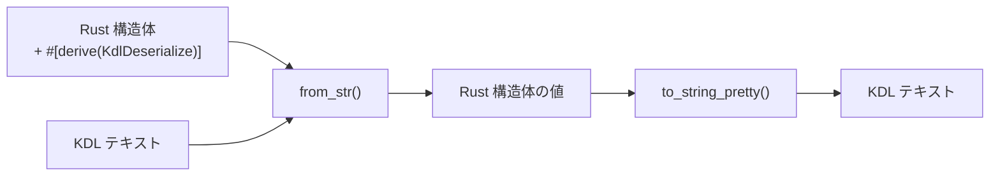
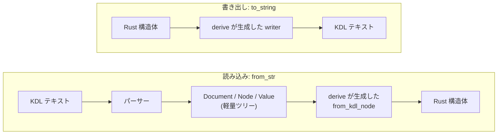

# club-kdl

[](https://crates.io/crates/club-kdl)
[](https://docs.rs/club-kdl)
[](https://github.com/chronista-club/club-kdl/actions/workflows/ci.yml)
[](#license)
[](https://github.com/chronista-club/club-kdl/blob/main/Cargo.toml)
[](https://crates.io/crates/club-kdl)

**[English](README.md)** | 日本語

Rust で [KDL](https://kdl.dev) を扱う **クレートファミリー** — 自前の高速 KDL v2 エンジンの上に載った derive ベースの serde、schema 駆動の多言語コード生成、複数ファイル合成までを 1 つの ecosystem に。

```toml
[dependencies]
club-kdl = "0.14"
# 任意の feature (どちらも既定は off):
# club-kdl = { version = "0.14", features = ["compose", "kdl-rs"] }
```

## クレートファミリー

`club-kdl` は workspace version を共有する 3 つの crate で構成され、まとめてリリースされる。用途に応じて使い分ける。

| Crate | 役割 | 使うとき |
|-------|------|---------|
| **[`club-kdl`](https://crates.io/crates/club-kdl)** | Rust 構造体 ↔ KDL テキストの derive ベース ser/de | Rust 型を KDL と往復させたい |
| [`club-kdl-derive`](https://crates.io/crates/club-kdl-derive) | `#[derive(KdlDeserialize, KdlSerialize)]` を実装する proc-macro | (内部依存 — `club-kdl` が引き込むので直接依存することはほぼ無い) |
| **[`club-kdl-codegen`](https://crates.io/crates/club-kdl-codegen)** | KDL schema → Rust / TypeScript / Zod / SurrealQL コード生成 (CLI + ライブラリ) | 1 つの KDL schema から多言語の型を生成したい |

`club-kdl` には任意の feature が 2 つある。 どちらも既定は off なので、 既定のビルドが依存するのは `club-kdl-derive` と `thiserror` だけ。

| Feature | 追加されるもの | 追加の依存 |
|---------|---------------|-----------|
| `compose` | `club_kdl::compose` — `(<)file` / `(<)glob` include directive による複数ファイル合成 ([下記](#複数ファイルの-kdl--compose-feature)) | `glob` |
| `kdl-rs` | kdl-rs との相互運用: `from_kdl_document` / `from_kdl_node` / `to_kdl_document`、 `From` 変換、 `club_kdl::kdl` の再エクスポート ([下記](#kdl-rs-との相互運用)) | `kdl` |

0.13 までは `compose` は別 crate の `club-kdl-compose` だった。 `kdl_compose::compose` は `club_kdl::compose::compose` になった。

このREADMEのほとんどは `club-kdl` 本体 (derive とそのエンジン) の説明。schema codegen と compose については下の [Schema codegen](#schema-codegen--club-kdl-codegen) / [複数ファイルの KDL](#複数ファイルの-kdl--compose-feature) を参照。

## なぜ `club-kdl`？

KDL の公式 Rust 実装 [`kdl-rs`](https://crates.io/crates/kdl) は **文書の編集** に向けたライブラリで、 コメントや空白まで保持し、 ファイルを書き換えても元の見た目のまま書き戻せる。 一方で Rust 構造体との往復は手書きが必要。 `club-kdl` はそちらの仕事のためのもので、 `#[derive(KdlDeserialize, KdlSerialize)]` だけで struct ↔ KDL の往復を完結させる。 しかも、 その用途に合わせた **自前の KDL v2 エンジン** で動く ([仕組み](#仕組み) を参照)。

| ライブラリ | 立ち位置 | 適性 |
|-----------|---------|------|
| [`kdl`](https://crates.io/crates/kdl) | KDL parser / 書式を保持する文書 | コメントやレイアウトを保ったままの KDL 編集 / spec 準拠の low-level 操作 |
| [`knuffel`](https://crates.io/crates/knuffel) / [`knus`](https://crates.io/crates/knus) | derive ベースの parser | spec 準拠重視 / parse 側に偏る |
| **`club-kdl`** | **自前エンジンの上の derive ベース ser/de** | **高速な struct ↔ KDL 双方向 / 親子ノード名自動解決 / enum data variants** |

両者は組み合わせて使える (`kdl-rs` feature が必要)。 kdl-rs のツリーは `from_kdl_document` / `from_kdl_node` で読め、 書式を保ったまま編集したいときは `to_kdl_document` で kdl-rs に渡せる。

---

## derive を付けると何が起こるか



構造体のフィールドと KDL のノード構造が `#[kdl(...)]` 属性で対応付けられる。

```rust
use club_kdl::{KdlDeserialize, KdlSerialize};

#[derive(Debug, KdlDeserialize, KdlSerialize)]
#[kdl(name = "service")]
struct Service {
    #[kdl(argument)]       // 位置引数 → "api"
    name: String,

    #[kdl(property)]       // プロパティ → image="myapp"
    image: String,

    #[kdl(children)]       // 子ノード → Port::kdl_node_name() で自動解決
    ports: Vec<Port>,
}

#[derive(Debug, KdlDeserialize, KdlSerialize)]
#[kdl(name = "port")]
struct Port {
    #[kdl(property)]
    host: u16,
    #[kdl(property)]
    container: u16,
}
```

この構造体で以下の KDL を読み書きできる:

```kdl
service "api" image="myapp" {
    port host=8080 container=80
    port host=8443 container=443
}
```

```rust
// デシリアライズ（KDL → Rust）
let service: Service = club_kdl::from_str(kdl_text).unwrap();

// シリアライズ（Rust → KDL）
let kdl_text = club_kdl::to_string_pretty(&service).unwrap();
```

---

## 仕組み

v0.13 から、 `club-kdl` は kdl-rs を通さずに読み書きする。 struct との往復のために設計した **自前の KDL v2 エンジン** (パーサーと writer) を持っている。



### 読み込み

1. **前から 1 回だけ読む。** パーサーは入力のバイト列を 1 度だけ走査する。 普通の ASCII は速い経路で処理し、 引用符付き文字列とコメントの中は SWAR (64 ビット整数演算で 8 バイトをまとめて判定する手法。 `unsafe` も追加の依存も無し) で 8 バイトずつ読み飛ばす。 UTF-8 のデコードは非 ASCII のバイトが来たときだけ行う。
2. **意味だけを残す。** 作るのは軽量なツリー (ノード名・型注釈・argument・property・子ノード) だけで、 空白・コメント・数値や文字列の元の書き方は持たない。
3. **コピーせずに借りる。** エスケープの解除が要らない文字列 (識別子、 ほとんどの引用符付き文字列、 1 行の raw 文字列) は、 新しく確保せずに入力テキストの該当部分を指す。
4. **写す。** `#[derive(KdlDeserialize)]` が生成したコードが、 そのツリーから直接フィールドを読む。

### 書き出し

`#[derive(KdlSerialize)]` が生成したコードは、 **中間のツリーを作らずに `String` へ直接書く**。 識別子として有効な文字列は引用符なしで、 それ以外は引用符とエスケープ付きで書き、 子ノードは 4 スペースで字下げする。 (ツリーが欲しいときは `to_kdl_node` / `to_doc` で引き続き作れる。)

### なぜ速いのか

kdl-rs はファイルの編集のために、 ノードや値ごとに元のテキスト・前後の空白・コメント・位置情報まで持った「書式を保持する文書」を組み立てる。 KDL を struct に変換するだけならそのどれも要らないので、 `club-kdl` は作らない。 差の大半はこれで説明できる。 残りは 1 回だけの走査、 文字列を借りること、 確保なしの書き出しによる。 数値は [ベンチマーク](#ベンチマーク) を参照。

### 手放したもの

コメントとレイアウトは **保持しない**。 ファイルを struct に読んで書き戻すと、 整形し直した KDL になる。 コメントを残したままファイルを書き換えたいときは、 その部分だけ kdl-rs を使う。 `kdl-rs` feature を有効にすれば、 `to_kdl_document` / `from_kdl_document` で両者の間を行き来できる。

### 正しさの担保

- **公式 KDL 2.0 テストスイート全件** (320 件) を CI で流している (`tests/spec_compliance.rs`)。
- 有効な spec の文書は、 すべて **パース → 書き出し → パース** で変わらないこと。
- **頑健性テスト** (`tests/robustness.rs`): 壊した入力をパーサーと derive の struct に読ませても panic しないこと、 任意の文字列 (引用符、 エスケープ、 制御文字、 各種の改行、 `true` や `-1` のような紛らわしいもの) が書き出し → 読み戻しで変わらないことを確かめる。 `CLUB_KDL_FUZZ_SCALE=50 cargo test --release --test robustness` で深く回せる。
- 子ノードの入れ子は 256 段までに制限している (悪意のある入力でスタックを使い果たさないため)。 パースエラーには行と列が付く (`line 2, column 3: ...`)。

---

## Schema codegen — `club-kdl-codegen`

型・プロトコルを **KDL で 1 度だけ定義**し、必要な言語ぶん生成する:

```kdl
# schema.kdl
struct "User" {
    field "id" type="string"
    field "name" type="string"
}

enum "Role" {
    variant "admin"
    variant "member"
}
```

```sh
$ club-kdl-codegen schema.kdl --target rust         # Rust struct / enum
$ club-kdl-codegen schema.kdl --target typescript   # TypeScript interface
$ club-kdl-codegen schema.kdl --target zod          # Zod ランタイムバリデータ
$ club-kdl-codegen schema.kdl --target surrealql    # SurrealQL DDL
```

schema 文法は **data 方言**（`struct` / `enum`）に加えて、 関係データの **entity 方言**（`record` / `relation` / `link<T>`）と IPC 用の **protocol 方言**（`protocol` / `channel` / `request` / `event`）をサポート。 channel は `envelope="t"` で **discriminated-union envelope** を opt-in でき、 Rust の `#[serde(tag = "t")]` enum、 TypeScript の判別 union、 Zod の `discriminatedUnion` を生成する。

詳細は [`club-kdl-codegen` の docs.rs](https://docs.rs/club-kdl-codegen) 参照。

---

## 複数ファイルの KDL — `compose` feature

schema や設定が大きくなったら、 `(<)file`（または batch import 用に `(<)glob`）で分割する。 まず feature を有効にする:

```toml
club-kdl = { version = "0.14", features = ["compose"] }
```

```kdl
# schema.kdl
(<)file "./types.kdl"

protocol "sidebar" version="1.0.0" {
    channel "ipc" from="client" envelope="t" {
        (<)file "./common-requests.kdl"
        request "specific:save" { field "data" type="string" }
    }
}
```

```kdl
# types.kdl
struct "User" { field "id" type="string" }
```

directive は **top-level でも任意の block の中でも**書けて、 cycle 検出つきで再帰的に解決される。 選択 import は children block で:

```kdl
(<)file "./types.kdl" as="shared" {
    only "User" "Memory"
    rename "User" "Acct"
}
```

これで取り込まれる top-level ノードの **first string argument** が `shared.Acct` / `shared.Memory` に rewrite される。 `club-kdl-codegen` CLI は内部でこれを使うので `(<)` directive はそのまま動く。 ライブラリから使うなら、 合成した `club_kdl::Document` を受け取る `club_kdl::compose::compose(path)` か、 合成と struct への読み込みを一度に行う `club_kdl::compose::from_path::<T>(path)` を呼ぶ。

directive 構文と制約は [docs.rs の `club_kdl::compose`](https://docs.rs/club-kdl/latest/club_kdl/compose/) 参照。

---

## 属性リファレンス

### 構造体属性

| 属性 | 説明 |
|------|------|
| `#[kdl(name = "...")]` | KDL ノード名（省略時は構造体名の snake_case） |
| `#[kdl(alias = "...")]` | ノード名の別名（複数指定可、デシリアライズ時に受け入れる） |
| `#[kdl(document)]` | KDL ドキュメント全体（複数トップレベルノード）として扱う |

### フィールド属性

| 属性 | 説明 |
|------|------|
| `#[kdl(argument)]` | 位置引数にマッピング（自動インデックス） |
| `#[kdl(argument(index = N))]` | 特定インデックスの引数にマッピング |
| `#[kdl(arguments)]` | 全引数を `Vec<T>` に収集 |
| `#[kdl(property)]` | 名前付きプロパティ（`key=value`） |
| `#[kdl(property(rename = "...")]` | 別名のプロパティにマッピング |
| `#[kdl(child)]` | 単一の子ノード（子型の `#[kdl(name)]` を自動参照） |
| `#[kdl(child(name = "...")]` | 明示名で子ノードを検索 |
| `#[kdl(child, unwrap_arg)]` | 子ノードの第1引数を値として取得 |
| `#[kdl(child, unwrap_args)]` | 子ノードの全引数を `Vec<T>` として取得 |
| `#[kdl(children)]` | 子ノードを `Vec<T>` に収集（子型の `#[kdl(name)]` を自動参照） |
| `#[kdl(children(name = "...")]` | 明示名で子ノードをフィルタして収集 |
| `#[kdl(child_map)]` | 子ノードを `HashMap<String, String>` に収集 |
| `#[kdl(child_map(name = "...")]` | ラッパーノード内の子を HashMap に収集 |
| `#[kdl(flatten)]` | 子構造体のフィールドを親ノードに展開 |
| `#[kdl(default)]` | 欠落時に `Default::default()` を使用 |
| `#[kdl(skip)]` | シリアライズ / デシリアライズをスキップ |

### Enum 属性

| 属性 | 用途 | 説明 |
|------|------|------|
| `#[kdl(rename = "...")]` | スカラー / データ | バリアント名の KDL 表現（省略時は snake_case） |

---

## Enum サポート

### スカラー Enum（プロパティ / 引数の値として使う）

全バリアントが unit（データなし）の enum は、文字列として KDL の引数やプロパティにマッピングされる。

```rust
#[derive(KdlDeserialize, KdlSerialize)]
enum Direction {
    #[kdl(rename = "client")]
    Client,
    #[kdl(rename = "server")]
    Server,
}

#[derive(KdlDeserialize, KdlSerialize)]
#[kdl(name = "channel")]
struct Channel {
    #[kdl(argument)]
    name: String,
    #[kdl(property)]
    from: Direction,
}
```

```kdl
channel "events" from="server"
```

### データ Enum（ノード名でバリアントを判別）

struct / newtype / unit バリアントを含む enum は、KDL ノード名でバリアントを判別する。

```rust
#[derive(KdlDeserialize, KdlSerialize)]
enum Command {
    // struct variant — フィールドはargument/property/childにマッピング
    #[kdl(rename = "move")]
    Move {
        #[kdl(property)]
        x: f64,
        #[kdl(property)]
        y: f64,
    },

    // newtype variant — 内部型にデリゲート
    #[kdl(rename = "configure")]
    Configure(InnerConfig),

    // unit variant — ノード名のみ
    #[kdl(rename = "quit")]
    Quit,
}
```

```kdl
move x=10.0 y=20.0
configure key="debug" value="true"
quit
```

### Vec<DataEnum> で子ノードを収集

データ enum は `#[kdl(children)]` と組み合わせて、異なるノード名の子を一括収集できる。

```rust
#[derive(KdlDeserialize, KdlSerialize)]
#[kdl(name = "pipeline")]
struct Pipeline {
    #[kdl(argument)]
    name: String,
    #[kdl(children)]
    steps: Vec<Command>,  // move, configure, quit を全て収集
}
```

```kdl
pipeline "deploy" {
    move x=1.0 y=2.0
    configure key="env" value="prod"
    quit
}
```

---

## 子ノードの名前自動解決

`#[kdl(child)]` / `#[kdl(children)]` は、子構造体の `#[kdl(name = "...")]` を自動参照する。
フィールド名と KDL ノード名が異なる場合でも、明示指定なしで正しくマッピングされる。

```rust
#[derive(KdlDeserialize)]
#[kdl(name = "post-setup")]
struct PostSetup {
    #[kdl(argument)]
    command: String,
}

#[derive(KdlDeserialize)]
#[kdl(document)]
struct Config {
    #[kdl(child)]                    // ← PostSetup::kdl_node_name() → "post-setup"
    post_setup: Option<PostSetup>,   //    フィールド名 "post_setup" ではなく "post-setup" で検索
}
```

```kdl
post-setup "bun install"
```

子構造体に `#[kdl(name)]` がない場合はフィールド名にフォールバックする。

---

## エイリアス

構造体に `#[kdl(alias = "...")]` を付けると、デシリアライズ時に別名も受け入れる。

```rust
#[derive(KdlDeserialize)]
#[kdl(name = "database", alias = "db")]
struct Database {
    #[kdl(argument)]
    url: String,
}
```

`database "pg://..."` でも `db "pg://..."` でもデシリアライズ可能。
`kdl_node_name()` は常に primary name（`"database"`）を返す。

---

## 使い方の例

### ドキュメント全体をパースする

KDL ファイルにトップレベルノードが複数ある場合は `#[kdl(document)]` を使う:

```rust
#[derive(KdlDeserialize)]
#[kdl(document)]
struct Config {
    #[kdl(children)]    // Stage::kdl_node_name() で自動解決
    stages: Vec<Stage>,

    #[kdl(children)]    // Service::kdl_node_name() で自動解決
    services: Vec<Service>,
}

let config: Config = club_kdl::from_str(kdl_text).unwrap();
```

### 全引数を収集する

```rust
#[derive(KdlDeserialize, KdlSerialize)]
#[kdl(name = "depends_on")]
struct DependsOn {
    #[kdl(arguments)]
    services: Vec<String>,
}
```

```kdl
depends_on "db" "redis" "cache"
```

### 子ノードマップ

```rust
#[derive(KdlDeserialize, KdlSerialize)]
#[kdl(name = "service")]
struct Service {
    #[kdl(argument)]
    name: String,

    #[kdl(child_map, name = "env")]
    environment: HashMap<String, String>,
}
```

```kdl
service "api" {
    env {
        DATABASE_URL "postgres://localhost/db"
        API_KEY "secret"
    }
}
```

### unwrap_arg / unwrap_args

子ノードの引数だけを値として取得する:

```rust
#[derive(KdlDeserialize, KdlSerialize)]
#[kdl(name = "app")]
struct App {
    #[kdl(child, unwrap_arg)]           // name "my-app" → "my-app"
    name: String,

    #[kdl(child, unwrap_args)]          // tags "web" "api" → vec!["web", "api"]
    tags: Vec<String>,
}
```

```kdl
app {
    name "my-app"
    tags "web" "api"
}
```

### flatten

子構造体のフィールドを親ノードに展開する:

```rust
#[derive(KdlDeserialize, KdlSerialize)]
#[kdl(name = "service")]
struct Service {
    #[kdl(argument)]
    name: String,

    #[kdl(flatten)]
    health: HealthCheck,
}

#[derive(KdlDeserialize, KdlSerialize)]
struct HealthCheck {
    #[kdl(property)]
    interval: u32,
    #[kdl(property)]
    timeout: u32,
}
```

```kdl
service "api" interval=30 timeout=5
```

### ツリーを直接扱う

`Document::parse` でツリーそのものが手に入る (schema も Cargo feature も不要)。 形の決まっていない文書を読むとき、 struct が記述していないノードを含む文書を読むとき (ツリーはすべてのノードを残す)、 文書の一部だけを struct に読むときに使う。

`(typ)service "api" image="nginx" { port 80; port 443; }` というノードなら:

| 欲しいもの | 呼び方 | この例で返るもの |
|-----------|-------|----------------|
| ノード名 | `node.name()` | `"service"` |
| 型注釈 | `node.ty()` | `Some("typ")` |
| 位置で指定した argument | `node.arg(0)` | 文字列 `"api"` |
| すべての argument | `node.args()` | `"api"` を返す iterator |
| property | `node.prop("image")` | 文字列 `"nginx"` (同じキーが複数あれば最後のもの) |
| argument と property を書かれた順に | `node.entries()` | `&[Entry]` |
| 名前で指定した最初の子 | `node.child("port")` | `port 80` のノード |
| 名前で指定したすべての子 | `node.children_named("port")` | 2 つの `port` ノードを返す iterator |
| すべての子 | `node.children()` | `&[Node]` (`{ }` ブロックが無ければ空) |
| トップレベルのノード | `doc.nodes()` | `&[Node]` |

値は `as_string()` / `as_integer()` / `as_float()` / `as_bool()` / `is_null()` で読む。 ツリーはパース元のテキストから文字列を借りるので、 テキストより長く持ちたいときは `into_owned()` を呼ぶ。


```rust
use club_kdl::{Document, KdlDeserialize};

let doc = Document::parse(text)?;
for node in doc.nodes() {
    println!("{} {:?}", node.name(), node.arg(0));
    if let Some(image) = node.prop("image").and_then(|v| v.as_string()) {
        println!("  image = {image}");
    }
    for port in node.children_named("port") {
        let port: Port = club_kdl::from_node(port)?;
    }
}
```

多数の値を書くとき (レコードのストリームなど) は、 バッファを使い回せる。

```rust
let mut out = String::new();
for event in &events {
    club_kdl::to_string_into(event, &mut out)?;
}
```

ファイルにノードを 1 つずつ追記する (NDKDL — 「改行区切りの KDL」) には `club_kdl::append_node(path, &value)` を使う。 追記後のファイルも有効な KDL 文書なので、 `#[kdl(document)]` の struct でそのまま読み戻せる。

### kdl-rs との相互運用

`kdl-rs` feature が必要:

```toml
club-kdl = { version = "0.14", features = ["kdl-rs"] }
```

```rust
// kdl-rs の文書 → struct (文字列はコピーせず借用する)
let kdl_doc: club_kdl::kdl::KdlDocument = text.parse()?;
let config: Config = club_kdl::from_kdl_document(&kdl_doc)?;

// struct → kdl-rs の文書。 コメントを足したり autoformat したりするとき
let mut kdl_doc = club_kdl::to_kdl_document(&config)?;
kdl_doc.autoformat();
```

feature を有効にすると `club_kdl::kdl` で kdl-rs crate を再エクスポートするので、 別途依存を足す必要は無い。

---

## サポートする型

| 型 | 読み込み | 書き出し |
|----|---------|---------|
| `i8`, `i16`, `i32`, `i64`, `i128`, `isize`, `u8`, `u16`, `u32`, `u64`, `usize` | ✓ (範囲外の値はエラー) | ✓ |
| `f32`, `f64` | ✓ | ✓ |
| `bool` | ✓ | ✓ |
| `String` | ✓ | ✓ |
| `&str`, `Cow<str>` | `FromKdlValue` / ツリー経由のみ (下記) | ✓ |
| `PathBuf` | ✓ | ✓ (`Path` も) |
| `Option<T>` (`#null` も値が無い場合も `None` として読む) | ✓ | ✓ |
| `Vec<T>`, `HashMap<String, String>` | ✓ | ✓ |

- カスタム型: `FromKdlValue` / `ToKdlValue` を実装する ([ガイド](docs/guide/custom-types.ja.md))。
- 現状、 derive した struct はデータを所有する。 `&'a str` 型のフィールドは derive がまだ対応していない。 エンジン自体はゼロコピーで、 `Document` は入力から借用し、 `FromKdlValue for &str` はツリーから借用するので、 手書きのコードならコピーせずに読める。

## ガイド

より詳しい使い方は [`docs/guide/`](docs/guide/README.ja.md) を参照:

- [カスタム型ガイド](docs/guide/custom-types.ja.md) — 独自型 (chrono 型・newtype など) を KDL 値にマッピング
- [KDL 設計ベストプラクティス](docs/guide/best-practices.ja.md) — argument / property / children の使い分けとアンチパターン
- [トラブルシュート](docs/guide/troubleshooting.ja.md) — よくあるエラーの原因と対処

## ベンチマーク

`benches/kdl_vs_json.rs` に同等の docker-compose 風データを KDL と JSON で読み書きするマイクロベンチがあります。

実測値 (Apple Silicon, Rust 1.95, criterion 中央値、 すべて同じ 1 回の計測。 絶対値は回ごとに揺れるので比率を見てください):

| operation | KDL (club-kdl) | kdl-rs 経由の KDL (≤ v0.12) | JSON (serde_json) |
|-----------|----------------|-----------------------------|-------------------|
| read (1.7 KB テキスト → struct) | 20.0 µs | 1288 µs | 9.7 µs |
| write (struct → テキスト) | 4.4 µs | 146 µs | 4.3 µs |

パースのスループット (`parse` グループ、 85 KB の文書): 同じ計測で club-kdl は約 110 MiB/s、 kdl-rs は約 1.3 MiB/s (負荷の無いマシンではさらに速い)。

実行:

```sh
cargo bench --bench kdl_vs_json
```

結果は HTML レポート (`target/criterion/report/index.html`) で詳細を確認できます。

**用途のガイド**: read は serde_json と同じ桁に収まったので、 リクエストごとに設定ファイルを読み直す使い方でも問題ありません。 ただし KDL は人が読み書きするためのフォーマットなので、 通信プロトコルや大量データには JSON / binary フォーマット (rkyv 等) が引き続き向いています。

以前の版から上げる場合は、 破壊的変更と移行手順を [CHANGELOG](CHANGELOG.md) (0.14.0 と 0.13.0) にまとめてある。

## MSRV (Minimum Supported Rust Version)

現在の MSRV は **Rust 1.95** です。 `Cargo.toml` の `rust-version` フィールドで管理し、 CI で継続的に検証しています。

MSRV の引き上げは **patch リリースで行うことがあります** (semver の慣習に準拠)。

## Contributing

[CONTRIBUTING.md](./CONTRIBUTING.md) を参照してください。 セキュリティ問題は [SECURITY.md](./SECURITY.md) の手順で報告をお願いします。

## License

このプロジェクトはあなたの選択により以下のいずれかでライセンスされています:

- Apache License, Version 2.0, ([LICENSE-APACHE](./LICENSE-APACHE) or <https://www.apache.org/licenses/LICENSE-2.0>)
- MIT license ([LICENSE-MIT](./LICENSE-MIT) or <https://opensource.org/licenses/MIT>)

### Contribution

特に明示的に別段の定めがない限り、 あなたが意図的に提出した、 Apache-2.0 ライセンスで定義されている、本作品に含めるためのコントリビューションは、 追加の条項なしに上記のようにデュアルライセンスされるものとします。
