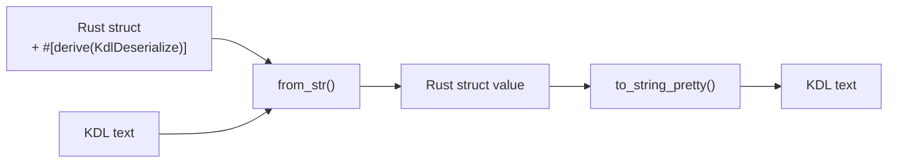
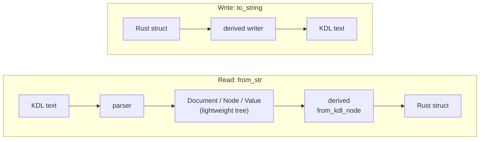

# club-kdl

[](https://crates.io/crates/club-kdl)
[](https://docs.rs/club-kdl)
[](https://github.com/chronista-club/club-kdl/actions/workflows/ci.yml)
[](#license)
[](https://github.com/chronista-club/club-kdl/blob/main/Cargo.toml)
[](https://crates.io/crates/club-kdl)

English | **[日本語](README.ja.md)**

A **family of crates** for working with [KDL](https://kdl.dev) in Rust — derive-based serde on its own fast KDL v2 engine, schema-driven multi-language code generation, and multi-file composition.

```toml
[dependencies]
club-kdl = "0.14"
# optional features, both off by default:
# club-kdl = { version = "0.14", features = ["compose", "kdl-rs"] }
```

## The crate family

`club-kdl` ships as three crates sharing a workspace version; reach for the one that matches the job.

| Crate | What it does | Reach for it when |
|-------|--------------|-------------------|
| **[`club-kdl`](https://crates.io/crates/club-kdl)** | Derive-based serialization / deserialization between Rust structs and KDL text | You have Rust types and want them to round-trip with KDL |
| [`club-kdl-derive`](https://crates.io/crates/club-kdl-derive) | Proc-macro behind `#[derive(KdlDeserialize, KdlSerialize)]` | (Internal — pulled in by `club-kdl`; rarely depended on directly) |
| **[`club-kdl-codegen`](https://crates.io/crates/club-kdl-codegen)** | KDL schema → Rust / TypeScript / Zod / SurrealQL code generator (CLI + library) | A single KDL schema should drive types in multiple languages |

`club-kdl` has two optional features, both off by default, so the default build depends only on `club-kdl-derive` and `thiserror`:

| Feature | What it adds | Extra dependency |
|---------|--------------|------------------|
| `compose` | `club_kdl::compose` — multi-file KDL via the `(<)file` / `(<)glob` include directive ([below](#multi-file-kdl-with-the-compose-feature)) | `glob` |
| `kdl-rs` | Interop with kdl-rs: `from_kdl_document` / `from_kdl_node` / `to_kdl_document`, `From` conversions, the `club_kdl::kdl` re-export ([below](#interop-with-kdl-rs)) | `kdl` |

Until 0.13, `compose` was the separate `club-kdl-compose` crate; `kdl_compose::compose` is now `club_kdl::compose::compose`.

The rest of this README is about `club-kdl` itself (the derive crate and its engine). For the schema generator and the composer, jump to [Schema codegen](#schema-codegen-with-club-kdl-codegen) and [Multi-file KDL](#multi-file-kdl-with-the-compose-feature) below.

## Why `club-kdl`?

The official Rust implementation of KDL, [`kdl-rs`](https://crates.io/crates/kdl), focuses on **document editing** — it keeps every comment and every bit of whitespace so a file can be changed and written back as it was. Converting to and from Rust structs is left to you. `club-kdl` is built for that other job: `#[derive(KdlDeserialize, KdlSerialize)]` is all you need for a full struct ↔ KDL round trip, and it runs on **its own KDL v2 engine** tuned for exactly that (see [How it works](#how-it-works)).

| Library | Role | Best for |
|---------|------|----------|
| [`kdl`](https://crates.io/crates/kdl) | KDL parser / format-preserving document | Editing KDL files while keeping comments and layout / spec-compliant low-level work |
| [`knuffel`](https://crates.io/crates/knuffel) / [`knus`](https://crates.io/crates/knus) | derive-based parser | Spec-compliance focused / parsing-oriented |
| **`club-kdl`** | **derive-based ser/de on its own engine** | **Fast bidirectional struct ↔ KDL / automatic parent-child node name resolution / enum data variants** |

The two work together (with the `kdl-rs` feature): kdl-rs trees can be read with `from_kdl_document` / `from_kdl_node`, and `to_kdl_document` hands a serialized value to kdl-rs when you need format-preserving edits.

---

## What the derive does



Struct fields are mapped to KDL node structure via `#[kdl(...)]` attributes.

```rust
use club_kdl::{KdlDeserialize, KdlSerialize};

#[derive(Debug, KdlDeserialize, KdlSerialize)]
#[kdl(name = "service")]
struct Service {
    #[kdl(argument)]       // positional argument → "api"
    name: String,

    #[kdl(property)]       // property → image="myapp"
    image: String,

    #[kdl(children)]       // child nodes → resolved via Port::kdl_node_name()
    ports: Vec<Port>,
}

#[derive(Debug, KdlDeserialize, KdlSerialize)]
#[kdl(name = "port")]
struct Port {
    #[kdl(property)]
    host: u16,
    #[kdl(property)]
    container: u16,
}
```

This struct can read and write the following KDL:

```kdl
service "api" image="myapp" {
    port host=8080 container=80
    port host=8443 container=443
}
```

```rust
// Deserialize (KDL → Rust)
let service: Service = club_kdl::from_str(kdl_text).unwrap();

// Serialize (Rust → KDL)
let kdl_text = club_kdl::to_string_pretty(&service).unwrap();
```

---

## How it works

Since v0.13, `club-kdl` no longer parses through kdl-rs. It has **its own KDL v2 engine** — a parser and a writer designed for mapping to and from structs.



### Reading

1. **Parse once, front to back.** The parser walks the input bytes a single time. Plain ASCII takes a fast path; inside quoted strings and comments it skips 8 bytes at a time with SWAR checks (plain 64-bit integer tricks, no `unsafe`, no extra dependency). UTF-8 is decoded only when a non-ASCII byte appears.
2. **Keep only the meaning.** The result is a lightweight tree — node names, type annotations, arguments, properties, children — and nothing else. Whitespace, comments and the original spelling of numbers and strings are not stored.
3. **Borrow instead of copying.** Strings that need no unescaping (identifiers, most quoted strings, single-line raw strings) point into the input text instead of being copied.
4. **Map.** The code generated by `#[derive(KdlDeserialize)]` reads fields straight from that tree.

### Writing

The code generated by `#[derive(KdlSerialize)]` writes **straight into a `String`** — no intermediate tree is built. Strings are written bare when they are valid identifiers and quoted with escapes otherwise; children are indented by four spaces. (`to_kdl_node` / `to_doc` still build a tree when you want one.)

### Why it is fast

kdl-rs builds a format-preserving document: every node and value carries its original text, surrounding whitespace, comments and source spans, because it is made for editing files. Turning KDL into structs needs none of that, so `club-kdl` skips it — that alone accounts for most of the difference. Single-pass scanning, borrowed strings and allocation-free writing do the rest. See [Benchmarks](#benchmarks) for numbers.

### What it gives up

Comments and layout are **not preserved**: reading a file into structs and writing it back produces normalized KDL. If you need to edit a file in place and keep its comments, use kdl-rs for that step — with the `kdl-rs` feature, `to_kdl_document` and `from_kdl_document` move data between the two.

### How correctness is checked

- The **full official KDL 2.0 test suite** (320 cases) runs in CI (`tests/spec_compliance.rs`).
- Every valid spec document must survive **parse → write → parse** unchanged.
- **Robustness tests** (`tests/robustness.rs`) feed mutated inputs to the parser and to derived structs (no panics allowed) and check that arbitrary strings — quotes, escapes, control characters, newline variants, text like `true` or `-1` — survive a write → read round trip. Run them deeper with `CLUB_KDL_FUZZ_SCALE=50 cargo test --release --test robustness`.
- Children nesting is capped at 256 levels so hostile input cannot exhaust the stack, and parse errors report a line and column (`line 2, column 3: ...`).

---

## Schema codegen with `club-kdl-codegen`

Define your types and protocols **once in KDL**, generate them in every language you need:

```kdl
# schema.kdl
struct "User" {
    field "id" type="string"
    field "name" type="string"
}

enum "Role" {
    variant "admin"
    variant "member"
}
```

```sh
$ club-kdl-codegen schema.kdl --target rust         # Rust structs / enums
$ club-kdl-codegen schema.kdl --target typescript   # TypeScript interfaces
$ club-kdl-codegen schema.kdl --target zod          # Zod runtime validators
$ club-kdl-codegen schema.kdl --target surrealql    # SurrealQL DDL
```

The schema dialect also supports the **entity dialect** (`record` / `relation` / `link<T>`) for relational/graph data and the **protocol dialect** (`protocol` / `channel` / `request` / `event`) for IPC schemas. Channels can opt-in to a **discriminated-union envelope** with `envelope="t"`, generating `#[serde(tag = "t")]` Rust enums, TypeScript discriminated unions, and Zod `discriminatedUnion`s.

See [`club-kdl-codegen` on docs.rs](https://docs.rs/club-kdl-codegen) for the full dialect reference.

---

## Multi-file KDL with the `compose` feature

When a schema or config gets large, split it across files and include with `(<)file` (or `(<)glob` for batch import). Enable the feature first:

```toml
club-kdl = { version = "0.14", features = ["compose"] }
```

```kdl
# schema.kdl
(<)file "./types.kdl"

protocol "sidebar" version="1.0.0" {
    channel "ipc" from="client" envelope="t" {
        (<)file "./common-requests.kdl"
        request "specific:save" { field "data" type="string" }
    }
}
```

```kdl
# types.kdl
struct "User" { field "id" type="string" }
```

The directive lives anywhere — top-level or inside any block — and resolves recursively with cycle detection. Selective import lives in a children block:

```kdl
(<)file "./types.kdl" as="shared" {
    only "User" "Memory"
    rename "User" "Acct"
}
```

This renames the first string argument of each top-level included node to `shared.Acct` / `shared.Memory`. The `club-kdl-codegen` CLI uses it internally, so `(<)` directives just work. From a library, call `club_kdl::compose::compose(path)` to get the composed `club_kdl::Document`, or `club_kdl::compose::from_path::<T>(path)` to compose and deserialize in one step.

See [`club_kdl::compose` on docs.rs](https://docs.rs/club-kdl/latest/club_kdl/compose/) for directive syntax and limits.

---

## Attribute reference

### Container attributes

| Attribute | Description |
|-----------|-------------|
| `#[kdl(name = "...")]` | KDL node name (defaults to the struct name in snake_case) |
| `#[kdl(alias = "...")]` | Alternative node name (multiple allowed; accepted during deserialization) |
| `#[kdl(document)]` | Treat as a whole KDL document (multiple top-level nodes) |

### Field attributes

| Attribute | Description |
|-----------|-------------|
| `#[kdl(argument)]` | Map to a positional argument (auto-indexed) |
| `#[kdl(argument(index = N))]` | Map to the argument at a specific index |
| `#[kdl(arguments)]` | Collect all arguments into a `Vec<T>` |
| `#[kdl(property)]` | Named property (`key=value`) |
| `#[kdl(property(rename = "...")]` | Map to a property with a different name |
| `#[kdl(child)]` | Single child node (resolves the child type's `#[kdl(name)]`) |
| `#[kdl(child(name = "...")]` | Look up a child node by explicit name |
| `#[kdl(child, unwrap_arg)]` | Take the child node's first argument as the value |
| `#[kdl(child, unwrap_args)]` | Take all of the child node's arguments as a `Vec<T>` |
| `#[kdl(children)]` | Collect child nodes into a `Vec<T>` (resolves the child type's `#[kdl(name)]`) |
| `#[kdl(children(name = "...")]` | Filter and collect child nodes by explicit name |
| `#[kdl(child_map)]` | Collect child nodes into a `HashMap<String, String>` |
| `#[kdl(child_map(name = "...")]` | Collect children inside a wrapper node into a HashMap |
| `#[kdl(flatten)]` | Expand a child struct's fields into the parent node |
| `#[kdl(default)]` | Use `Default::default()` when missing |
| `#[kdl(skip)]` | Skip this field during serialization / deserialization |

### Enum attributes

| Attribute | Applies to | Description |
|-----------|------------|-------------|
| `#[kdl(rename = "...")]` | scalar / data | KDL representation of the variant name (defaults to snake_case) |

---

## Enum support

### Scalar enums (used as property / argument values)

An enum where all variants are unit (no data) is mapped to a string in a KDL argument or property.

```rust
#[derive(KdlDeserialize, KdlSerialize)]
enum Direction {
    #[kdl(rename = "client")]
    Client,
    #[kdl(rename = "server")]
    Server,
}

#[derive(KdlDeserialize, KdlSerialize)]
#[kdl(name = "channel")]
struct Channel {
    #[kdl(argument)]
    name: String,
    #[kdl(property)]
    from: Direction,
}
```

```kdl
channel "events" from="server"
```

### Data enums (variant identified by node name)

An enum containing struct / newtype / unit variants identifies the variant by the KDL node name.

```rust
#[derive(KdlDeserialize, KdlSerialize)]
enum Command {
    // struct variant — fields map to argument/property/child
    #[kdl(rename = "move")]
    Move {
        #[kdl(property)]
        x: f64,
        #[kdl(property)]
        y: f64,
    },

    // newtype variant — delegates to the inner type
    #[kdl(rename = "configure")]
    Configure(InnerConfig),

    // unit variant — node name only
    #[kdl(rename = "quit")]
    Quit,
}
```

```kdl
move x=10.0 y=20.0
configure key="debug" value="true"
quit
```

### Collecting child nodes with `Vec<DataEnum>`

Combined with `#[kdl(children)]`, a data enum can collect children with different node names in one go.

```rust
#[derive(KdlDeserialize, KdlSerialize)]
#[kdl(name = "pipeline")]
struct Pipeline {
    #[kdl(argument)]
    name: String,
    #[kdl(children)]
    steps: Vec<Command>,  // collects all of move, configure, quit
}
```

```kdl
pipeline "deploy" {
    move x=1.0 y=2.0
    configure key="env" value="prod"
    quit
}
```

---

## Automatic child node name resolution

`#[kdl(child)]` / `#[kdl(children)]` automatically resolve the child struct's `#[kdl(name = "...")]`. Even when the field name differs from the KDL node name, the mapping is correct without an explicit name.

```rust
#[derive(KdlDeserialize)]
#[kdl(name = "post-setup")]
struct PostSetup {
    #[kdl(argument)]
    command: String,
}

#[derive(KdlDeserialize)]
#[kdl(document)]
struct Config {
    #[kdl(child)]                    // ← PostSetup::kdl_node_name() → "post-setup"
    post_setup: Option<PostSetup>,   //    looked up as "post-setup", not the field name "post_setup"
}
```

```kdl
post-setup "bun install"
```

If the child struct has no `#[kdl(name)]`, it falls back to the field name.

---

## Aliases

Adding `#[kdl(alias = "...")]` to a struct makes deserialization accept the alternative name too.

```rust
#[derive(KdlDeserialize)]
#[kdl(name = "database", alias = "db")]
struct Database {
    #[kdl(argument)]
    url: String,
}
```

Both `database "pg://..."` and `db "pg://..."` deserialize successfully. `kdl_node_name()` always returns the primary name (`"database"`).

---

## Usage examples

### Parsing a whole document

When a KDL file has multiple top-level nodes, use `#[kdl(document)]`:

```rust
#[derive(KdlDeserialize)]
#[kdl(document)]
struct Config {
    #[kdl(children)]    // resolved via Stage::kdl_node_name()
    stages: Vec<Stage>,

    #[kdl(children)]    // resolved via Service::kdl_node_name()
    services: Vec<Service>,
}

let config: Config = club_kdl::from_str(kdl_text).unwrap();
```

### Collecting all arguments

```rust
#[derive(KdlDeserialize, KdlSerialize)]
#[kdl(name = "depends_on")]
struct DependsOn {
    #[kdl(arguments)]
    services: Vec<String>,
}
```

```kdl
depends_on "db" "redis" "cache"
```

### Child node map

```rust
#[derive(KdlDeserialize, KdlSerialize)]
#[kdl(name = "service")]
struct Service {
    #[kdl(argument)]
    name: String,

    #[kdl(child_map, name = "env")]
    environment: HashMap<String, String>,
}
```

```kdl
service "api" {
    env {
        DATABASE_URL "postgres://localhost/db"
        API_KEY "secret"
    }
}
```

### unwrap_arg / unwrap_args

Take only a child node's arguments as the value:

```rust
#[derive(KdlDeserialize, KdlSerialize)]
#[kdl(name = "app")]
struct App {
    #[kdl(child, unwrap_arg)]           // name "my-app" → "my-app"
    name: String,

    #[kdl(child, unwrap_args)]          // tags "web" "api" → vec!["web", "api"]
    tags: Vec<String>,
}
```

```kdl
app {
    name "my-app"
    tags "web" "api"
}
```

### flatten

Expand a child struct's fields into the parent node:

```rust
#[derive(KdlDeserialize, KdlSerialize)]
#[kdl(name = "service")]
struct Service {
    #[kdl(argument)]
    name: String,

    #[kdl(flatten)]
    health: HealthCheck,
}

#[derive(KdlDeserialize, KdlSerialize)]
struct HealthCheck {
    #[kdl(property)]
    interval: u32,
    #[kdl(property)]
    timeout: u32,
}
```

```kdl
service "api" interval=30 timeout=5
```

### Working with the tree directly

`Document::parse` gives you the tree itself — no schema, no Cargo feature. Use it when a document has no fixed shape, when it contains nodes your structs do not describe (the tree keeps them all), or to deserialize only part of a document.

For a node like `(typ)service "api" image="nginx" { port 80; port 443; }`:

| You want | Call | Here it returns |
|----------|------|-----------------|
| the node name | `node.name()` | `"service"` |
| its type annotation | `node.ty()` | `Some("typ")` |
| an argument by position | `node.arg(0)` | the string `"api"` |
| all arguments | `node.args()` | an iterator over `"api"` |
| a property | `node.prop("image")` | the string `"nginx"` (if a key repeats, the last one wins) |
| arguments and properties in written order | `node.entries()` | `&[Entry]` |
| the first child with a name | `node.child("port")` | the `port 80` node |
| every child with a name | `node.children_named("port")` | an iterator over both `port` nodes |
| all children | `node.children()` | `&[Node]`, empty when there is no `{ }` block |
| the top-level nodes | `doc.nodes()` | `&[Node]` |

Values are read with `as_string()` / `as_integer()` / `as_float()` / `as_bool()` / `is_null()`. The tree borrows strings from the text it was parsed from; call `into_owned()` to keep it longer.


```rust
use club_kdl::{Document, KdlDeserialize};

let doc = Document::parse(text)?;
for node in doc.nodes() {
    println!("{} {:?}", node.name(), node.arg(0));
    if let Some(image) = node.prop("image").and_then(|v| v.as_string()) {
        println!("  image = {image}");
    }
    for port in node.children_named("port") {
        let port: Port = club_kdl::from_node(port)?;
    }
}
```

Reuse one buffer when writing many values (e.g. a stream of records):

```rust
let mut out = String::new();
for event in &events {
    club_kdl::to_string_into(event, &mut out)?;
}
```

To append records to a file one node at a time (NDKDL — "newline-delimited KDL"), use `club_kdl::append_node(path, &value)`; the file stays a valid KDL document that a `#[kdl(document)]` struct can read back.

### Interop with kdl-rs

Requires the `kdl-rs` feature:

```toml
club-kdl = { version = "0.14", features = ["kdl-rs"] }
```

```rust
// kdl-rs document → struct (strings are borrowed, not copied)
let kdl_doc: club_kdl::kdl::KdlDocument = text.parse()?;
let config: Config = club_kdl::from_kdl_document(&kdl_doc)?;

// struct → kdl-rs document, e.g. to add comments or autoformat
let mut kdl_doc = club_kdl::to_kdl_document(&config)?;
kdl_doc.autoformat();
```

With the feature on, `club_kdl::kdl` re-exports the kdl-rs crate, so no separate dependency is needed.

---

## Supported types

| Type | Read | Write |
|------|------|-------|
| `i8`, `i16`, `i32`, `i64`, `i128`, `isize`, `u8`, `u16`, `u32`, `u64`, `usize` | ✓ (out-of-range values are an error) | ✓ |
| `f32`, `f64` | ✓ | ✓ |
| `bool` | ✓ | ✓ |
| `String` | ✓ | ✓ |
| `&str`, `Cow<str>` | via `FromKdlValue` / tree only (see below) | ✓ |
| `PathBuf` | ✓ | ✓ (`Path` too) |
| `Option<T>` (`#null` and a missing value both read as `None`) | ✓ | ✓ |
| `Vec<T>`, `HashMap<String, String>` | ✓ | ✓ |

- Custom types: implement `FromKdlValue` / `ToKdlValue` ([guide](docs/guide/custom-types.md)).
- Derived structs own their data today: a field typed `&'a str` is not supported by the derive yet. The engine itself is zero-copy — `Document` borrows from the input, and `FromKdlValue for &str` borrows from the tree — so hand-written code can read without copying.

## Guides

For more detailed usage, see [`docs/guide/`](docs/guide/README.md):

- [Custom Types Guide](docs/guide/custom-types.md) — map your own types (chrono types, newtypes, etc.) to KDL values
- [KDL Design Best Practices](docs/guide/best-practices.md) — choosing between argument / property / children, and anti-patterns
- [Troubleshooting](docs/guide/troubleshooting.md) — common errors and their fixes

## Benchmarks

`benches/kdl_vs_json.rs` contains a micro-benchmark that reads and writes equivalent docker-compose-like data in both KDL and JSON.

Measured values (Apple Silicon, Rust 1.95, criterion median, all from one run — absolute numbers drift between runs, ratios are steadier):

| operation | KDL (club-kdl) | KDL via kdl-rs (≤ v0.12) | JSON (serde_json) |
|-----------|----------------|--------------------------|-------------------|
| read (1.7 KB text → structs) | 20.0 µs | 1288 µs | 9.7 µs |
| write (structs → text) | 4.4 µs | 146 µs | 4.3 µs |

Parse throughput (`parse` group, 85 KB document): ~110 MiB/s for club-kdl vs ~1.3 MiB/s for kdl-rs in the same run (higher on an idle machine).

Run it with:

```sh
cargo bench --bench kdl_vs_json
```

Detailed results are available in the HTML report (`target/criterion/report/index.html`).

**Usage guidance**: reads are now within a small factor of serde_json, so re-reading config files on every request is fine. KDL is still a human-oriented format: for wire protocols and bulk data, JSON or a binary format (such as rkyv) remains the better fit.

Upgrading from an earlier version? The breaking changes and migration steps are in the [CHANGELOG](CHANGELOG.md) (0.14.0 and 0.13.0).

## MSRV (Minimum Supported Rust Version)

The current MSRV is **Rust 1.95**. It is managed via the `rust-version` field in `Cargo.toml` and continuously verified in CI.

MSRV bumps **may happen in a patch release** (following the semver convention).

## Contributing

See [CONTRIBUTING.md](./CONTRIBUTING.md). Please report security issues following the procedure in [SECURITY.md](./SECURITY.md).

## License

This project is licensed under either of the following, at your option:

- Apache License, Version 2.0, ([LICENSE-APACHE](./LICENSE-APACHE) or <https://www.apache.org/licenses/LICENSE-2.0>)
- MIT license ([LICENSE-MIT](./LICENSE-MIT) or <https://opensource.org/licenses/MIT>)

### Contribution

Unless you explicitly state otherwise, any contribution intentionally submitted for inclusion in the work by you, as defined in the Apache-2.0 license, shall be dual licensed as above, without any additional terms or conditions.

---

> 📝 This English README is the **canonical source** going forward. [`README.ja.md`](README.ja.md) is the Japanese translation; if the two ever disagree, this English version is authoritative.
