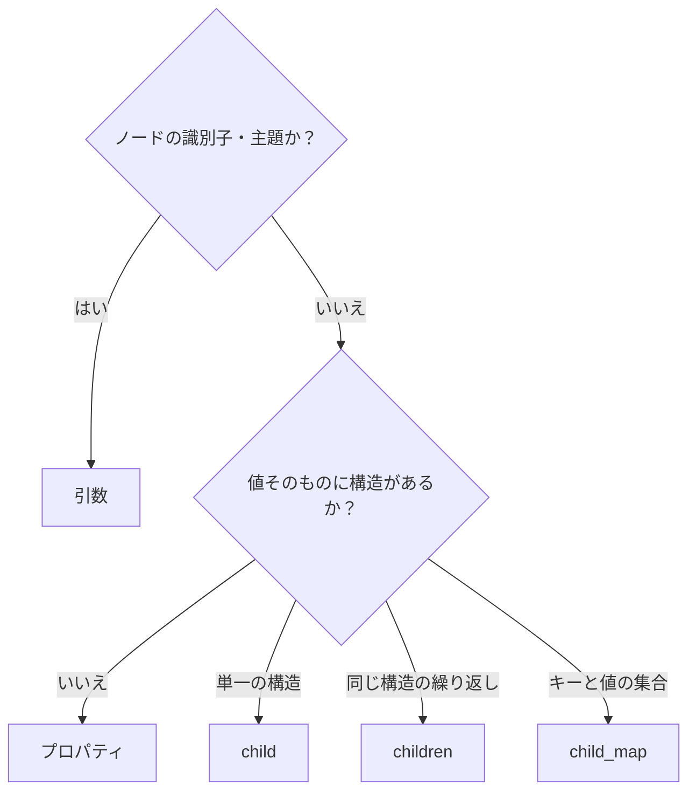

# KDL 設計のベストプラクティス

**[English](./best-practices.md)** | 日本語

読みやすく保守しやすい KDL スキーマを設計するための指針と、避けたい例を紹介する。

## 概要

KDL ノードには、位置で指定する**引数**、`key=value` で書く**プロパティ**、入れ子の**子ノード**がある。同じデータでも複数の書き方ができるため、使い分けの基準を揃えるとスキーマを読みやすく保てる。

## 引数とプロパティの使い分け

| 要素 | 性質 | 向いている用途 |
|---|---|---|
| 引数 | 位置で識別し、順序に意味がある | ノードの主題や識別子。1〜2 個を目安にする |
| プロパティ | 名前で識別し、順序に依存しない | 属性。特に省略可能なものや、数が多いもの |

「何を表すノードか」は引数、「どのような属性を持つか」はプロパティ、と考える。

```kdl
// Good: the name (subject) is an argument, attributes are properties
service "api" image="myapp" replicas=3
```

```kdl
// Anti-pattern: everything as arguments ―― you can't tell which position is what
service "api" "myapp" 3
```

引数が 3 個以上になったら、その多くをプロパティにできないか検討する。

## child / children / child_map の使い分け

| 属性 | 個数や構造 | Rust の型 |
|---|---|---|
| `#[kdl(child)]` | 単一の子。`Option<T>` なら省略可能 | `T` / `Option<T>` |
| `#[kdl(children)]` | 同じ種類の子の繰り返し | `Vec<T>` |
| `#[kdl(child_map)]` | キーと値の組の集合 | `HashMap<String, String>` |

## まとめるためだけのノードを作らない

```kdl
// Anti-pattern: the `ports` wrapper is redundant in KDL terms
service "api" {
    ports {
        port host=8080
        port host=8443
    }
}
```

```kdl
// Good: place child nodes directly
service "api" {
    port host=8080
    port host=8443
}
```

club-kdl の `#[kdl(children)]` は、子の型の `#[kdl(name)]` に合うノードを自動で集める。そのため、グループ化するだけのラッパーノードは不要。

## 単純な値はプロパティ、構造を持つ値は子ノードにする

```kdl
// Good: scalar values as properties
service "api" image="myapp"
```

```kdl
// Redundant: a scalar value needlessly made a child node
service "api" {
    image "myapp"
}
```

子ノードを使うのは、その値自身に引数・プロパティ・子ノードなどの構造がある場合を基本とする。

## flatten で不要な入れ子を省く

補助的な構造体を別のノードに分けず、親ノードの中に展開したいときは `#[kdl(flatten)]` を使う。

```rust
#[derive(KdlDeserialize, KdlSerialize)]
#[kdl(name = "service")]
struct Service {
    #[kdl(argument)]
    name: String,
    #[kdl(flatten)]
    health: HealthCheck,   // interval / timeout sit directly on service
}
```

```kdl
service "api" interval=30 timeout=5
```

Rust 側では型を分けて責務を整理しつつ、KDL 側では平坦な表現にできる。

## 状態や種類にはスカラー列挙型を使う

種類・方向・モードなど、選択肢が決まっている値には `String` よりもスカラー列挙型が向いている。

```rust
#[derive(KdlDeserialize, KdlSerialize)]
enum Protocol {
    #[kdl(rename = "tcp")]
    Tcp,
    #[kdl(rename = "udp")]
    Udp,
}
```

タイプミスや未定義の値をデシリアライズ時に検出でき、KDL に記した値の意味も分かりやすくなる。

## 選び方のフローチャート



## 関連項目

- 属性ごとの構文は README の「属性リファレンス」を参照
- [カスタム型ガイド](./custom-types.ja.md): プロパティや引数で使える値の型を拡張する
